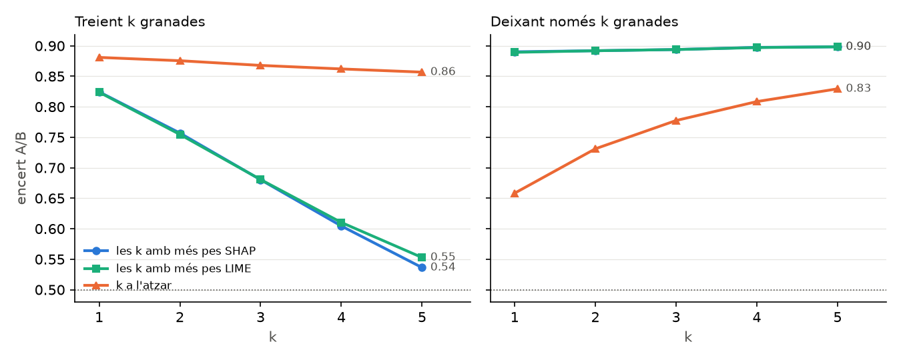
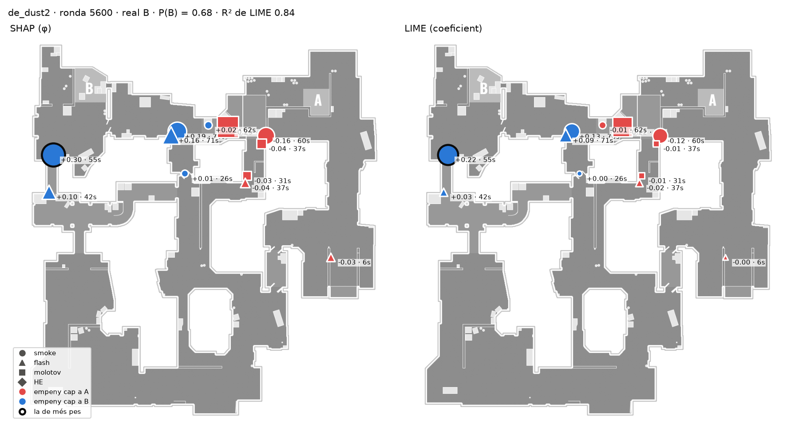

# Explicabilitat: LIME sobre DeepSets, i la diferència amb SHAP

> LIME (Ribeiro et al., 2016) per a la cap de site (A contra B), comparat ronda a ronda amb el SHAP
> exacte de `RESULTATS-SHAP.md`. **Cada ronda l'explica el model del fold que no ha vist el seu
> equip**: els mateixos 5 models de SHAP i Anchors (llavor 0, encert 0.8862).
>
> 3565 rondes amb plant i alguna granada (les 20 sense utility no tenen res a explicar) ·
> 42.107 granades. Un càlcul de 8 min (5 processos), 2026-11-08.
>
> Codi: `app/ml/lime.py`, `scripts/lime_report.py`, `tests/test_lime.py`. JSON crus a
> `data_store/lime/` (`fold0-4.json` amb cada ronda, `summary.json`). Figures a
> `docs/figures/lime/`.

---

## 0. La resposta curta

| | LIME | SHAP |
|---|---|---|
| Granada més important: la mateixa que SHAP | **91,5 %** de les rondes (a l'atzar, 10,8 %) | — |
| Correlació de rang amb SHAP dins la ronda (Spearman) | **0.887** | — |
| Encert traient les 5 més importants (a l'atzar: 0.857) | **0.553** | 0.536 |
| Encert deixant només la més important | 0.889 | 0.890 |
| Callouts: correlació del pes mitjà (230 callouts) | **0.953** | — |
| Callouts: mateixos 3 de cada site per mapa | 48 de 54 | — |
| Les contribucions sumen la predicció menys la base | **no** (s'hi desvien 0.255 de mitjana) | sí, exacte |
| Mida de les contribucions | **0,39 ×** les de SHAP (mediana) | — |
| Pes d'una granada passats 60 s, respecte dels primers 15 s | ×8,1 | ×3,4 |
| Ajust del model lineal local (R²) | 0.537 · **0.330** quan el model està segur (≥ 0.97) | no en té |
| Dues execucions: mateixa granada principal | 96,4 % | 100 % (exacte al 99 %) |
| Temps per ronda | 40 ms, gairebé constant | 497 ms: 5 ms fins a 10 granades, 2 s de 16 a 20 |

**Lectura per a la memòria.** LIME i SHAP diuen el mateix sobre **quines** granades decideixen el
site i **on** cauen: mateix ordre, mateixos callouts i la mateixa fidelitat al test de borrat. On
es diferencien és en **què vol dir el número**. LIME mira què passa quan es treu una granada de la
ronda gairebé sencera; SHAP fa la mitjana sobre rondes de totes les mides. Com que el model es
decideix amb una o dues granades i la resta no hi afegeix res, LIME dona pesos més petits, no
sumen la predicció, i el seu model lineal ajusta pitjor com més segur està el model. Que dos
mètodes diferents arribin a les mateixes granades i callouts fa més creïbles les conclusions de
SHAP.

---

## 1. Mètode

**Igual que SHAP, cada granada és una variable**: present o absent. Treure-la vol dir la mateixa
ronda sense ella, que DeepSets llegeix tal qual.

**Com `LimeTextExplainer`, amb granades en lloc de paraules.** L'explicador tabular de la
llibreria espera un nombre fix de variables, com passava amb SHAP i Anchors; el de text no, perquè
cada document té les seves paraules. Està fet a mà, per poder passar els 5000 subconjunts per la
xarxa en un sol batch, però amb els valors per defecte de la llibreria:

| | |
|---|---|
| Mostres per ronda | 5000: la ronda sencera, i 4999 on es treuen k ~ U{1..n} granades a l'atzar |
| Pes de cada mostra | nucli exponencial sobre la distància cosinus a la ronda sencera (×100, amplada 25) |
| Model local | ridge amb α = 1 sobre la presència de cada granada, ajustat a P(B) |
| Resultat | un coeficient per granada (cap a B si és positiu), l'R² del model lineal |

Els tests comproven que el nucli dona el mateix que la fórmula de la llibreria amb
`cosine_distances` de sklearn, i que la ridge dona el mateix que `sklearn.linear_model.Ridge` amb
pesos (`test_lime.py`).

---

## 2. SHAP també mostreja? Què separa LIME de SHAP

La manera genèrica de calcular SHAP, la de la llibreria per a qualsevol model (`KernelExplainer`,
Lundberg i Lee 2017), **és LIME amb tres canvis**: el pes de cada mostra surt del nucli de Shapley en lloc de la
distància, no hi ha regularització, i s'imposa que les contribucions sumin la predicció menys la
base. I mostreja, com LIME. La d'aquest treball enumera totes les coalicions (2ⁿ) quan la ronda té
fins a 20 granades, el 99 % de les rondes, i llavors el resultat és exacte.

Per separar l'efecte del pes del del mostreig, sobre **les mateixes 5000 mostres** de cada ronda
s'ajusten els dos models:

| Sobre les mateixes mostres | Spearman amb SHAP exacte | mateixa granada principal | error mitjà de φ | Σ = predicció − base |
|---|---|---|---|---|
| nucli de LIME + ridge | 0.887 | **91,5 %** | — (escala 0,39 ×) | no |
| nucli de Shapley + restricció (KernelSHAP) | **0.949** | 80,2 % | **0.006** | sí |

- **El que separa LIME de SHAP és com pesa les mostres, no el mostreig.** Amb les mateixes
  mostres i el pes de Shapley, els φ surten a 0.006 dels exactes. Amb totes les coalicions, la
  regressió dona exactament els valors de Shapley (`test_kernel_shap_over_every_coalition_is_exact_shapley`,
  error < 10⁻¹⁰).
- **Mostrejar té un cost.** Amb 5000 mostres, KernelSHAP encerta la granada principal només en el
  80 % de les rondes. Amb Shapley, dues granades que fan la mateixa feina (dues smokes a B Doors)
  es reparteixen el mèrit gairebé a parts iguals, i un error petit les intercanvia. Per això es
  calcula exacte.
- Matís: aquest KernelSHAP fa servir el mostreig de LIME. La llibreria mostreja millor (enumera
  primer les coalicions més petites i més grans), així que el 80 % és una cota baixa del que
  donaria, no la seva xifra.

---

## 3. Fidelitat: el test de borrat

El mateix test de `RESULTATS-SHAP.md` §2, amb l'ordre de LIME: es treuen (o es deixen només) les k
granades amb més pes cap al site predit. Rondes amb més de k granades. «Canvia» = la predicció
passa a l'altre site.

| k | rondes | ronda sencera | − k SHAP | − k LIME | − k atzar | canvia SHAP | canvia LIME | canvia atzar |
|---|---|---|---|---|---|---|---|---|
| 1 | 3531 | 0.890 | 0.824 | 0.824 | 0.881 | 12,9 % | 13,2 % | 2,1 % |
| 2 | 3468 | 0.892 | 0.757 | 0.755 | 0.876 | 24,2 % | 24,5 % | 3,7 % |
| 3 | 3391 | 0.894 | 0.680 | 0.681 | 0.868 | 34,3 % | 34,4 % | 5,4 % |
| 4 | 3274 | 0.897 | 0.604 | 0.610 | 0.862 | 43,0 % | 42,4 % | 6,6 % |
| 5 | 3088 | 0.898 | **0.536** | **0.553** | 0.857 | 50,7 % | 49,0 % | 7,9 % |

Deixant-ne només k, els dos donen el mateix que la ronda sencera (0.889–0.898; a l'atzar,
0.658–0.829).



**Com a rànquing, LIME és tan fidel com SHAP**: fins a k = 3 la diferència és de 0.002, i a k = 5
SHAP treu 0.017 més d'encert.

---

## 4. Acord granada a granada

| | Spearman | mateixa principal | top 3 en comú | mateix signe (ponderat per \|φ\|) |
|---|---|---|---|---|
| LIME contra SHAP | 0.887 | 91,5 % | 91,6 % | 92,1 % |
| LIME contra LIME amb una altra llavor | 0.935 | 96,4 % | 96,2 % | 99,1 % |
| a l'atzar | — | 10,8 % | — | — |

**Quan no coincideixen és gairebé un empat.** En 300 de les 3531 rondes amb ≥ 2 granades, la
principal de LIME no és la de SHAP. En el 76,7 % és la segona de SHAP (89,3 %, entre les 3
primeres), i en aquestes rondes la primera i la segona de SHAP es diferencien un **2,0 %**
(mediana), contra un 18,3 % quan coincideixen. La de LIME és la més tardana en el 64,3 %.

Per mapa, l'acord és semblant a tot arreu (Spearman 0.847–0.915, mateixa principal 88,7–94,2 %).

---

## 5. On es diferencien: la mida, la suma i el moment

**El pes de cada mostra segons quantes granades queden** (ronda de 12 granades):

| granades que queden | 11 | 9 | 6 | 3 | 1 |
|---|---|---|---|---|---|
| pes a LIME | 0.99 | 0.87 | 0.50 | 0.14 | 0.02 |

LIME mira sobretot rondes a les quals falta poc. Allà, treure una de les tres granades que
apunten a B gairebé no mou la predicció: les altres dues ja hi són. SHAP compta també les
coalicions petites, on aquella granada sola mou molt P(B). D'aquí surten les tres diferències:

- **Mida**: Σ|coef| de LIME és 0,39 vegades Σ|φ| (mediana per ronda), i no suma la predicció
  menys la base (desviació mitjana 0.255).
- **Moment**: la utility d'obertura, dins la ronda sencera, no afegeix res a la de l'execute, i
  LIME la descompta més (×8,1 entre >60 s i 0–15 s, contra ×3,4 de SHAP). La conclusió és la
  mateixa: l'execute pesa més que l'obertura.
- **Tipus**: igual que a SHAP, gairebé no importa (smoke 35,8 %, flash 28,1 %, molotov 30,5 % i
  HE 5,6 % del pes, contra 32,8 / 31,5 / 27,7 / 8,0 %).

**El model no és lineal on està segur.** L'R² del model lineal de LIME mesura quant s'hi assembla
el model al voltant de la ronda:

| Confiança del model | rondes | R² |
|---|---|---|
| 0.5–0.7 | 372 | 0.796 |
| 0.7–0.9 | 1062 | 0.671 |
| 0.9–0.97 | 1397 | 0.475 |
| ≥ 0.97 | 734 | **0.330** |

Quan la ronda ja té prou evidència, P(B) es satura: una granada a B Doors basta, i la segona no
suma. Un model lineal no pot dir «n'hi ha prou amb una», i per això ajusta pitjor justament a les
rondes clares. La predicció local de LIME per a la ronda sencera sí que s'hi acosta (error mitjà
0.023; cau a l'altre costat de 0.5 en el 0,5 % de les rondes).

---

## 6. Callouts

φ mitjà de SHAP contra coeficient mitjà de LIME per callout (≥ 15 granades), cap a B:

| Mapa | correlació | mateixos 3 cap a A | mateixos 3 cap a B |
|---|---|---|---|
| de_ancient | 0.963 | 3 | 3 |
| de_anubis | 0.962 | 3 | 3 |
| de_cache | 0.979 | 3 | 3 |
| de_dust2 | 0.964 | 3 | 3 |
| de_inferno | 0.967 | **1** | 2 |
| de_mirage | 0.962 | 2 | 2 |
| de_nuke | **0.994** | 3 | 3 |
| de_overpass | 0.956 | 2 | 3 |
| de_train | 0.969 | 3 | 3 |
| **tots (230 callouts)** | **0.953** | | |

Les taules de callouts de `RESULTATS-SHAP.md` §4 surten gairebé iguals amb LIME. On canvien, és
per un callout veí del mateix site: a inferno, cap a A, LIME diu Library, A Site i Pit; SHAP,
Graveyard, A Site i Back Site (A). A nuke, LIME també dona el nivell inferior com el senyal més
clar de B (Decon, Bottom Ramp, B Site).

---

## 7. Cost

| Granades | rondes | LIME | SHAP exacte |
|---|---|---|---|
| 1–10 | 1292 | 30 ms | **5 ms** |
| 11–15 | 1445 | 39 ms | 93 ms |
| 16–20 | 794 | 58 ms | **2050 ms** |
| > 20 (SHAP per permutacions) | 34 | 58 ms | 71 ms |
| **total** | 3565 | **143 s** | **1771 s** |

SHAP exacte creix amb 2ⁿ i LIME no. Amb poques granades SHAP és més ràpid; de 16 a 20 és 35 vegades
més lent. Amb les rondes d'aquest treball tots dos són viables.

---

## 8. Una ronda

La mateixa ronda de dust2 de `RESULTATS-SHAP.md` §4. La granada amb més pes (vora negra) és la
mateixa: la smoke dels 55 s, +0.30 a SHAP i +0.22 a LIME. La flash dels 42 s passa de +0.10 a
+0.03, i la utility d'obertura queda a 0. L'R² de LIME és alt (0.84) perquè el model no hi està
segur (P(B) = 0.68).



---

## 9. Limitacions

- **Una sola llavor i només la cap de site**, com SHAP i Anchors.
- **Implementat a mà**, no amb la llibreria (no accepta un nombre variable de variables). Els
  valors per defecte i les fórmules són els seus, i els tests ho comproven contra sklearn.
- **LIME depèn de l'amplada del nucli (25)**. És la de la llibreria per a text. Amb una amplada
  més gran s'acostaria a pesar igual totes les mides, i els coeficients canviarien. No s'ha
  provat.
- **El KernelSHAP del §2 fa servir les mostres de LIME**, no el mostreig de la llibreria `shap`.
- **Coalicions que el model no ha vist**: la mateixa limitació que SHAP (§7 de
  `RESULTATS-SHAP.md`). LIME en pateix menys perquè pesa poc les rondes amb poques granades.

---

## 10. Com reproduir-ho

Fa servir els models de `data_store/shap/models/` (de `shap_report.py --stage explain`) i els JSON
de SHAP per a la comparació.

```bash
# al contenidor del backend, amb lime_report.py i shap_report.py copiats a /app
python lime_report.py --stage explain --jobs 5   # LIME, KernelSHAP i SHAP cronometrat (8 min)
python lime_report.py --stage report             # taules, summary.json i figures (segons)
```

Tests:

```bash
cd backend && PYTHONPATH=. ./.venv/bin/python -m pytest tests/test_lime.py -q
```
