# Explicabilitat: SHAP sobre DeepSets

> Valors de Shapley per a les tres caps de DeepSets (site, gate i timing). **Cada ronda
> l'explica un model que no ha vist el seu equip**: els 5 folds d'equips no vistos de la llavor 0,
> els mateixos de `RESULTATS-COMPARATIVA.md`. Comprovat: l'encert A/B surt **0.8862**, igual que
> la llavor 0 de DeepSets, o sigui que s'expliquen els mateixos models.
>
> 6675 rondes (3585 plants) · 55 equips · 9 mapes · 42.107 granades a les rondes amb plant.
> Un sol càlcul de 26 min (5 processos, CPU del portàtil a ~1 GHz), 2026-10-31.
>
> Codi: `app/ml/explain.py` (SHAP), `scripts/shap_report.py` (bateria i figures),
> `tests/test_explain.py`. JSON crus a `data_store/shap/` (`fold0-4.json` amb cada ronda,
> `summary.json`, i els models de cada fold a `models/`). Figures a `docs/figures/shap/`.

---

## 0. La resposta curta

| | |
|---|---|
| Granades per ronda (mitjana) | 11,7 |
| Pes de la granada més important | **26 %** del Σ\|φ\| de la ronda |
| Pes de les 3 més importants | **56 %** |
| Encert deixant només la més important | **0.890** (ronda sencera: 0.890) · a l'atzar: 0.658 |
| Encert traient-ne les 5 més importants | **0.536** · a l'atzar: 0.857 |
| Pes d'una granada llançada passats els 60 s, respecte dels primers 15 s | **×3,4** |
| Callouts que delaten el site: mitjana \|φ\| per callout | 0.053–0.067; **nuke 0.040** |
| Gate: pes de les granades / armes / economia / equip / fase | 62 % / 22 % / 11 % / 4 % / 2 % |
| Timing: la granada que més pesa és l'última llançada | **63 %** (a l'atzar, 11 %) |

**Lectura per a la memòria.** El model decideix el site amb **poques granades, les de l'execute**,
i segons **on cauen**, no de quin tipus són. SHAP ho diu i el test de borrat ho confirma: traient
les 5 granades que SHAP marca, el model queda gairebé a l'atzar (0.536); traient-ne 5 qualsevol,
gairebé no es mou (0.857). Els callouts que surten són els que diria un jugador (B Doors i
B Default Plant a dust2, Hell i Olof cap a A a train). A nuke, el mapa on el model falla més
(0.791), el nivell inferior delata B més que cap altre callout, però el 61 % de les granades
cauen a A Site i Outside, que no apunten a cap site.

---

## 1. Mètode

**Jugadors.** Cada granada de la ronda és un jugador. **Treure una granada vol dir la mateixa
ronda sense ella.** DeepSets rep un conjunt de mida variable, així que la ronda sense una granada
és una entrada normal i no cal inventar un valor de referència. La coalició buida és la ronda
sense utility.

| Cap | Sortida explicada | Jugadors | Rondes |
|---|---|---|---|
| site | P(B) (la de A n'és la contrària) | granades | 3585 plants |
| gate | P(NoPlant) | granades + 4 grups de context | 6675 |
| timing | P(rush), P(default), P(late) | granades | plants amb utility |

**Context de la gate.** Quatre grups: **equip** (equip i rival), **economia** (compra i valor de
l'equip, propis i del rival), **armes** (les dels dos equips) i **fase**. Treure'n un el deixa en
el valor que l'app envia amb el filtre a «Qualsevol» (`?` per a les categories, 0,5 per als
escalars i les armes). Els recomptes d'utility del context (`u_*`, `n_util`, `t_min`…) segueixen
les granades de la coalició: una granada treta també en surt.

**Càlcul.**

- **Fins a 20 jugadors, exacte**: s'avaluen les 2ⁿ coalicions en un sol batch (fins a 1 M de
  passades per ronda) i s'aplica la fórmula de Shapley. Site: el 99,1 % de les rondes; gate: el
  87,5 % (té 4 jugadors més).
- **Per sobre, mostreig per permutacions** (Castro et al. 2009): 512 permutacions, la meitat
  inverses de l'altra meitat.
- Comprovacions: la suma dels φ dona exactament la predicció menys la base (error màxim 8,8·10⁻¹⁵);
  el càlcul en batch coincideix amb la xarxa a totes les coalicions; l'exacte coincideix amb la
  definició; el mostreig convergeix a l'exacte (`test_explain.py`).

**Probabilitat sense utility.** P(B) = 0.406 de mitjana: sense cap granada, el model tira cap a A.

---

## 2. Fidelitat: el test de borrat

Una explicació només serveix si diu el que fa el model. Per cada ronda amb plant s'ordenen les
granades pel seu φ cap al site predit i es treuen (o es deixen només) les k primeres. Es compara
amb treure'n o deixar-ne k a l'atzar (32 sortejos per ronda). Només rondes amb més de k granades.

| k | rondes | ronda sencera | − k SHAP | − k atzar | canvia (SHAP) | canvia (atzar) | només k SHAP | només k atzar |
|---|---|---|---|---|---|---|---|---|
| 1 | 3531 | 0.890 | 0.824 | 0.881 | 12,9 % | 2,1 % | **0.890** | 0.658 |
| 2 | 3468 | 0.892 | 0.757 | 0.876 | 24,2 % | 3,7 % | 0.892 | 0.731 |
| 3 | 3391 | 0.894 | 0.680 | 0.868 | 34,3 % | 5,4 % | 0.894 | 0.777 |
| 4 | 3274 | 0.897 | 0.604 | 0.862 | 43,0 % | 6,6 % | 0.897 | 0.809 |
| 5 | 3088 | 0.898 | **0.536** | 0.857 | 50,7 % | 7,9 % | 0.898 | 0.829 |

«Canvia» = rondes on la predicció passa a l'altre site. Deixant només la granada més important,
la predicció canvia en el **0,08 %** de les rondes; deixant-ne una a l'atzar, en el 31 %.
Comprovat a part, passant aquella granada sola per la xarxa sense el codi de SHAP (500 rondes del
fold 0, coincideixen totes).

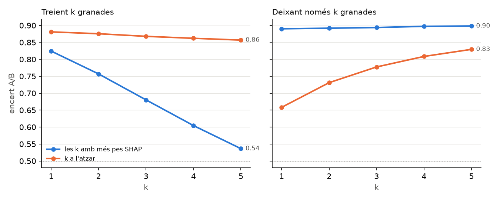

Matís: amb el pooling per atenció, una granada sola decideix tot el vector agregat, i el φ ja
inclou aquesta coalició d'un sol element. «Deixar-ne només k» afavoreix SHAP per construcció.
«Treure'n k» no té aquest biaix i és la prova que val.

---

## 3. Tipus i moment de la granada (cap de site)

| Tipus | granades | % de granades | % del Σ\|φ\| | \|φ\| mitjà |
|---|---|---|---|---|
| smoke | 12.922 | 30,7 % | 32,8 % | 0.068 |
| flash | 14.133 | 33,6 % | 31,5 % | 0.060 |
| molotov | 10.270 | 24,4 % | **27,7 %** | **0.072** |
| HE | 4.782 | 11,4 % | **8,0 %** | 0.045 |

| Moment del llançament | granades | \|φ\| mitjà |
|---|---|---|
| 0–15 s | 14.470 | 0.033 |
| 15–30 s | 7.872 | 0.052 |
| 30–45 s | 6.258 | 0.068 |
| 45–60 s | 5.042 | 0.081 |
| > 60 s | 8.465 | **0.113** |

- **El tipus gairebé no importa**: cada tipus pesa més o menys el que n'hi ha. La molotov una mica
  més; la HE menys.
- **El moment sí**: el pes creix a cada franja i passats els 60 s és 3,4 vegades el dels primers
  15 s. La utility d'obertura és control de mapa i serveix per als dos sites; la de l'execute és la
  que el delata.

---

## 4. Callouts que delaten el site

φ mitjà cap a B de les granades que cauen a cada callout (callouts amb ≥ 15 granades; negatiu =
cap a A). Les zones són les de `/maps/edit`, amb el nivell de la granada a nuke (la primera
versió d'aquest document, del 31-10, posava les granades del nivell inferior als callouts de dalt i
en treia que nuke no tenia callouts clars; corregit l'1-11).

| Mapa | Cap a A | Cap a B |
|---|---|---|
| de_ancient | CT Lane −0.15 · A Site −0.13 · Big Box −0.13 | Square +0.10 · Alley +0.08 · Back Halls +0.08 |
| de_anubis | Heaven −0.10 · Plateau −0.07 · A Connector −0.07 | Palace +0.13 · Default +0.13 · Street +0.12 |
| de_cache | A Site −0.09 · A Long −0.08 · CT Spawn −0.08 | Hell +0.11 · B Site +0.10 · Vents +0.07 |
| de_dust2 | Goose −0.11 · A Default Plant −0.11 · Elevator −0.09 | **B Default Plant +0.21** · B Doors +0.15 · Double Stack +0.13 |
| de_inferno | Graveyard −0.09 · A Site −0.09 · Back Site (A) −0.09 | Garden +0.15 · Coffins +0.14 · CT +0.13 |
| de_mirage | Default −0.07 · A Site −0.07 · CT −0.07 | **Door +0.21** · Van +0.17 · Bench +0.16 |
| de_nuke | Heaven −0.13 · Hell −0.08 · Turn Pike −0.08 | **Decon +0.29** · **Bottom Ramp +0.26** · **B Site +0.24** |
| de_overpass | Lobby −0.15 · Upper Park −0.09 · A Site −0.09 | Canal +0.10 · B Site +0.09 · Bridge +0.09 |
| de_train | Hell −0.13 · Olof −0.12 · Pigeons −0.11 | Yellow +0.18 · CT Spawn +0.17 · Bomb Train (B) +0.13 |

**Quant discriminen els callouts de cada mapa** (\|φ\| mitjà dels callouts, ponderat per
granades) contra l'encert del mapa en aquests mateixos folds:

| Mapa | callouts | granades | \|φ\| per callout | màxim | encert A/B |
|---|---|---|---|---|---|
| de_train | 30 | 3.048 | 0.067 | 0.180 | 0.824 |
| de_mirage | 30 | 5.816 | 0.060 | 0.205 | 0.911 |
| de_inferno | 26 | 4.005 | 0.059 | 0.147 | 0.912 |
| de_cache | 12 | 2.202 | 0.057 | 0.108 | 0.932 |
| de_dust2 | 43 | 10.383 | 0.056 | 0.212 | 0.911 |
| de_anubis | 22 | 4.516 | 0.054 | 0.128 | 0.885 |
| de_overpass | 16 | 1.924 | 0.054 | 0.146 | 0.907 |
| de_ancient | 30 | 5.277 | 0.053 | 0.148 | 0.890 |
| **de_nuke** | 21 | 4.426 | **0.040** | **0.294** | **0.791** |

- A **nuke** hi ha els callouts més clars de tots els mapes, els del nivell inferior (Decon,
  Bottom Ramp, B Site, Vent, Window i Doors, de +0.18 a +0.29), però només hi cau el 7,7 % de les
  granades. El 61 % cauen a A Site (1.216, −0.02) i Outside (1.499, +0.01), que no apunten a cap
  site. Per això la mitjana del mapa és la més baixa, i probablement per això hi falla el model:
  la majoria de la utility de nuke es llança a zones que serveixen per als dos sites. Ja ho
  apuntava la comparativa (§5): el problema de nuke no és l'arquitectura.
- **Train** és l'altre mapa fluix (0.824), però per un altre motiu: els callouts sí que
  discriminen (el valor més alt, 0.067). Hi falla per alguna altra cosa, que SHAP no explica.

Mapes per mapa, amb cada callout pintat pel seu φ mitjà (vermell = cap a A, blau = cap a B):

| | | |
|---|---|---|
| 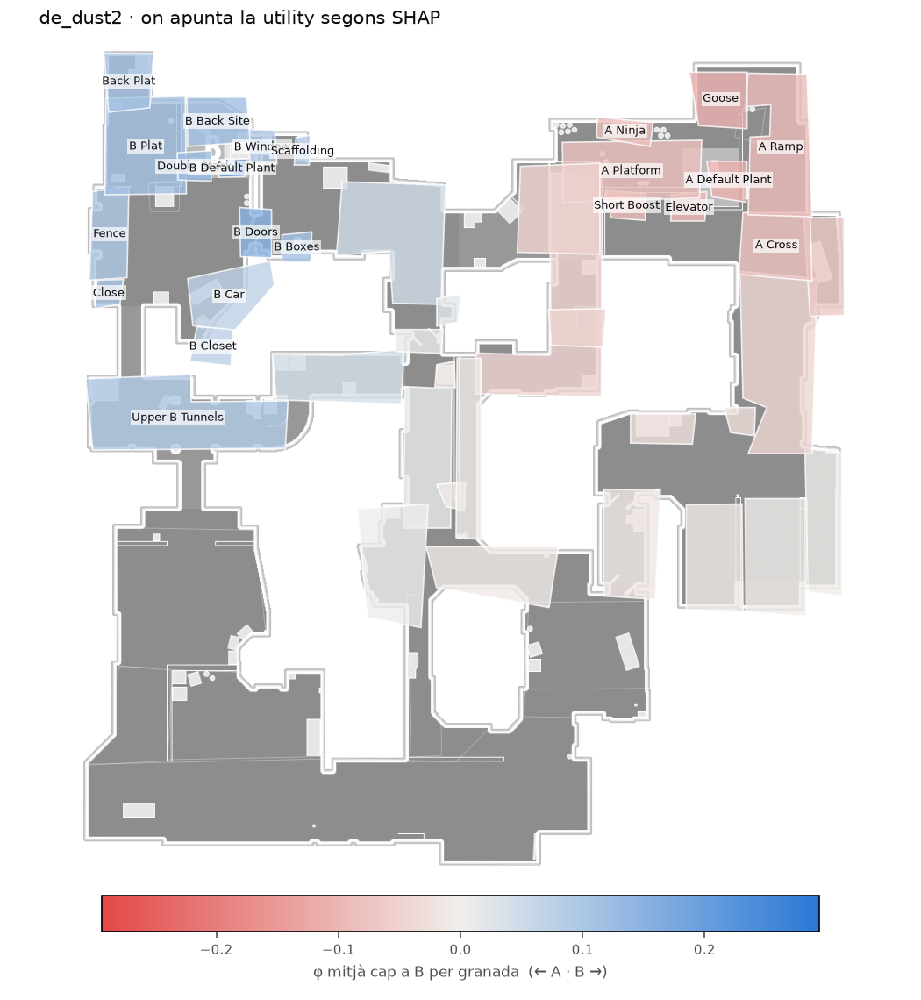 | 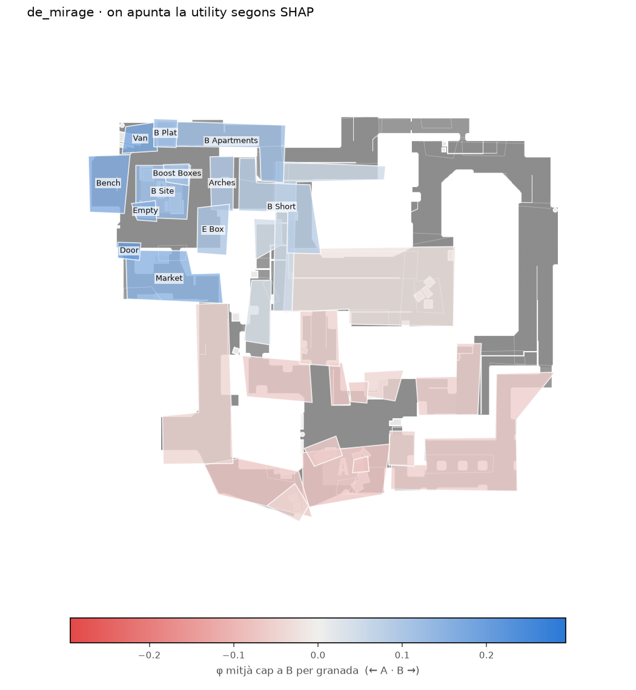 | 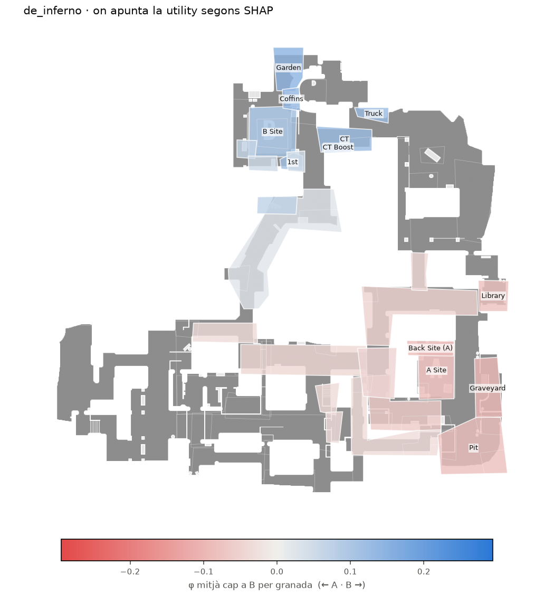 |
| 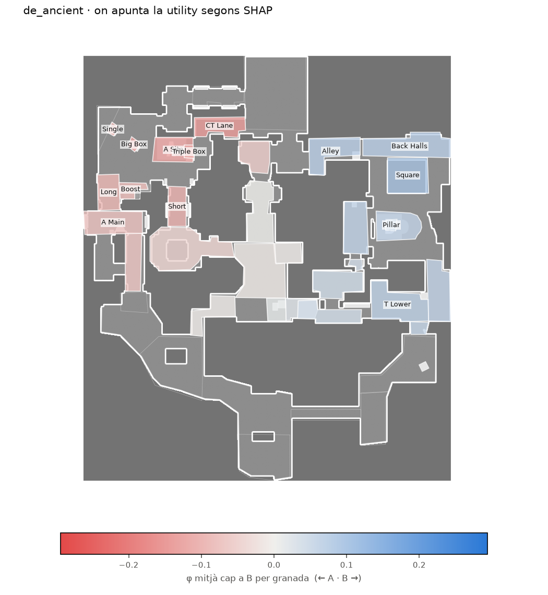 | 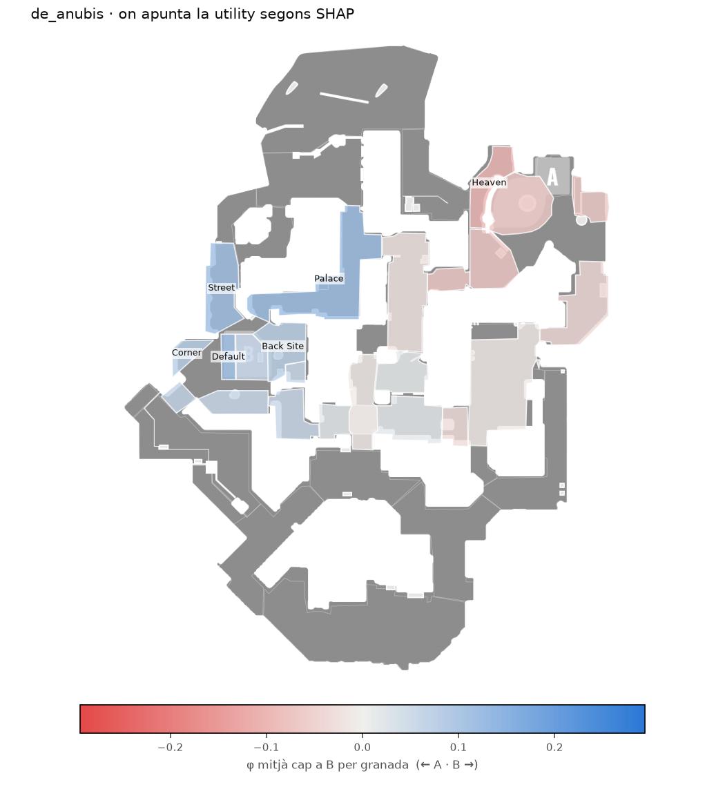 | 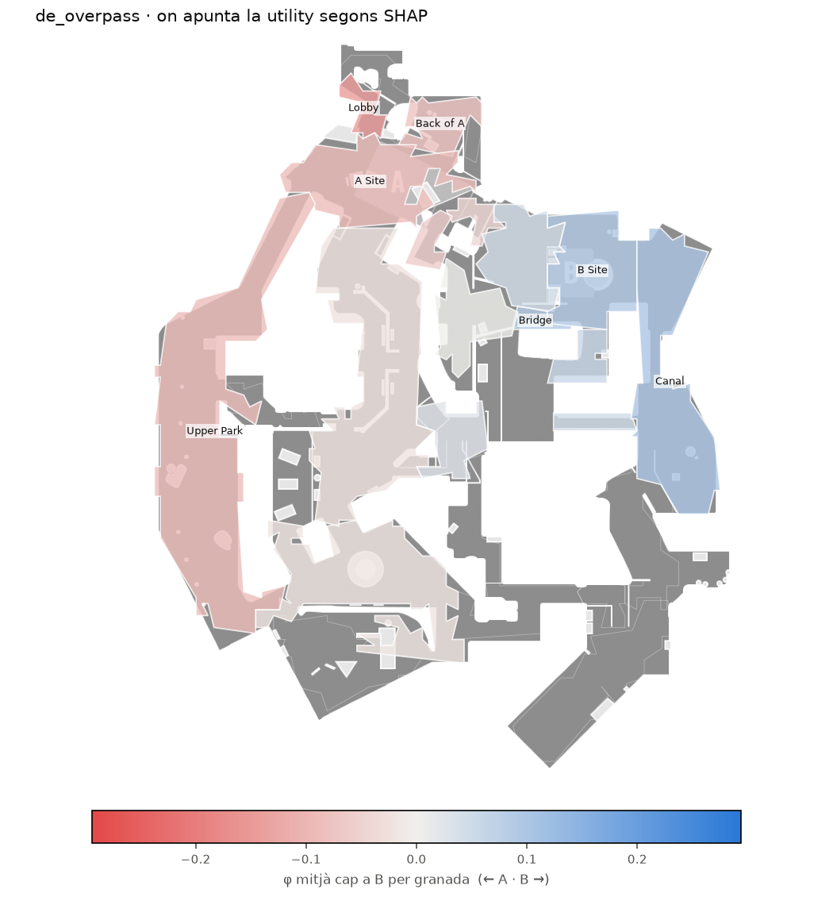 |
| 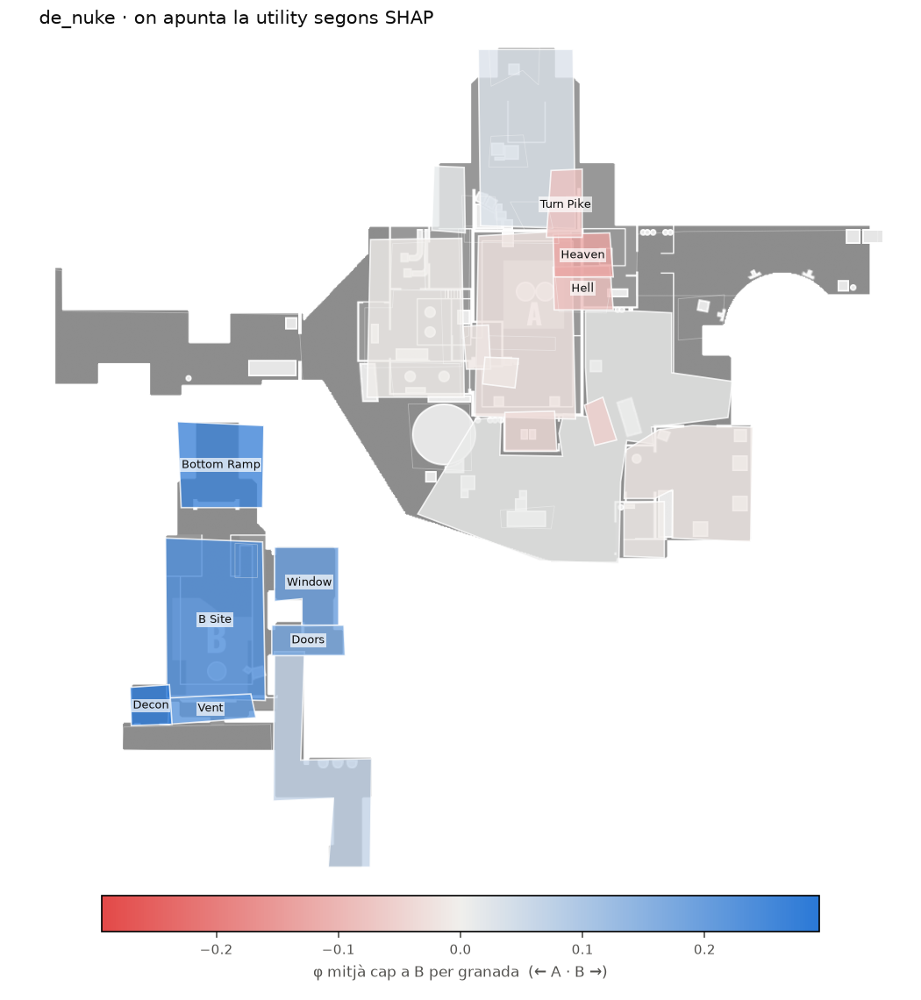 | 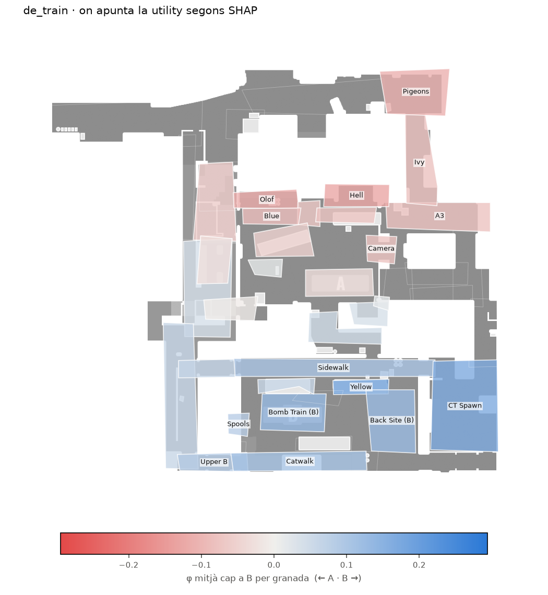 | 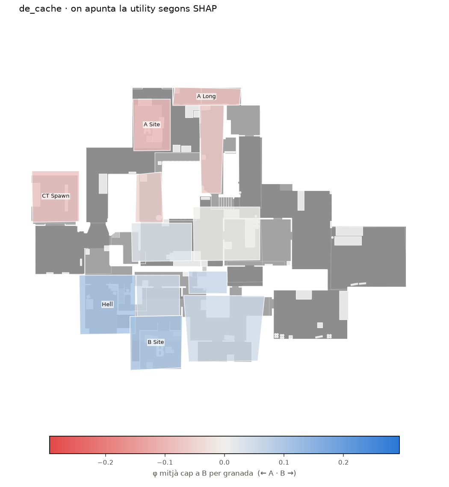 |

**Una ronda de cada mapa**, explicada granada a granada: la ronda encertada, d'entre 6 i 12
granades, amb més estira-i-arronsa entre A i B. La mida és el pes; el color, cap a on empeny;
l'etiqueta, φ i el segon del llançament. Exemple, dust2:

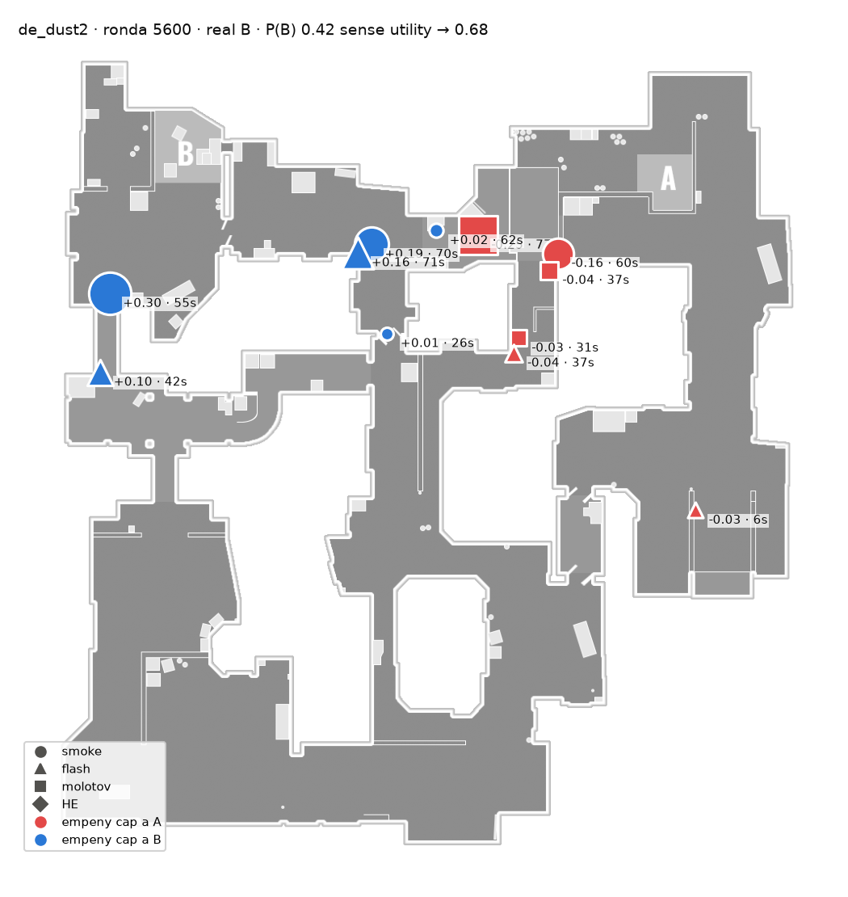

Les altres 8 són a `figures/shap/example_<mapa>.png`.

---

## 5. Gate: plant o NoPlant

Part mitjana del Σ\|φ\| de cada ronda (6675 rondes; exacte al 87,5 %):

| Jugador | pes |
|---|---|
| granades (totes juntes) | **61,6 %** |
| armes | **21,5 %** |
| economia | 11,0 % |
| equip | 3,6 % |
| fase | 2,3 % |

- Les granades també manen a la gate, no només el context.
- **Les armes pesen el doble que l'economia**, tot i que bona part de la informació es solapa (qui
  no compra rifles fa eco). Amb grups correlacionats, Shapley reparteix el pes entre tots dos, així
  que la suma (32,5 %) és més fiable que el repartiment.
- **L'equip pesa poc en part per construcció**: en aquests folds l'equip de test no s'ha vist mai,
  així que el seu one-hot ja és zero i el 3,6 % ve només del rival.

---

## 6. Timing

En el **63,3 %** de les 3531 rondes amb plant i ≥ 2 granades, la granada amb més pes cap al timing predit és **l'última
llançada**. A l'atzar seria l'11 % (1/n de mitjana). SHAP confirma el que deia `RESULTATS.md`:
la cap de timing llegeix sobretot l'hora de l'última granada (regla «última granada + 9 s»:
0.868; cap: 0.880).

---

## 7. Limitacions

- **Coalicions que el model no ha vist.** Treure granades pot deixar rondes que no s'assemblen a
  cap de l'entrenament, i allà el model extrapola. Al test sintètic, on totes les rondes tenien
  smoke i flash, un flash sol es llegia com una smoke. Amb dades reals el risc és menor (les
  rondes tenen de 0 a 23 granades), però hi és.
- **Els valors «Qualsevol» del context** (`?`, 0,5) tampoc no surten mai a l'entrenament; és el
  mateix que fa l'app quan no es filtra.
- **Una sola llavor** (la 0). Les xifres agregades (milers de granades) no haurien de moure's
  gaire entre llavors, però no està mesurat.
- **Només DeepSets.** La GCN i el Set Transformer no s'han explicat.
- **El φ és per granada, no per variable**: no separa quant ve de la posició, del moment o del
  tipus. Les taules del §3 i §4 ho aproximen agrupant granades.

---

## 8. Com reproduir-ho

```bash
# al contenidor del backend, amb el script copiat a /app
python shap_report.py --stage explain --jobs 5   # entrena els 5 folds i explica (26 min)
python shap_report.py --stage report             # taules, summary.json i figures (segons)
```

Si `data_store/shap/models/` ja té els models, `explain` no torna a entrenar.

Tests:

```bash
cd backend && PYTHONPATH=. ./.venv/bin/python -m pytest tests/test_explain.py -q
```
